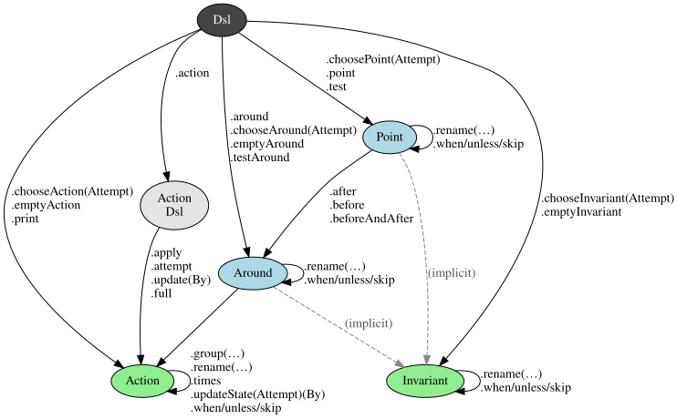
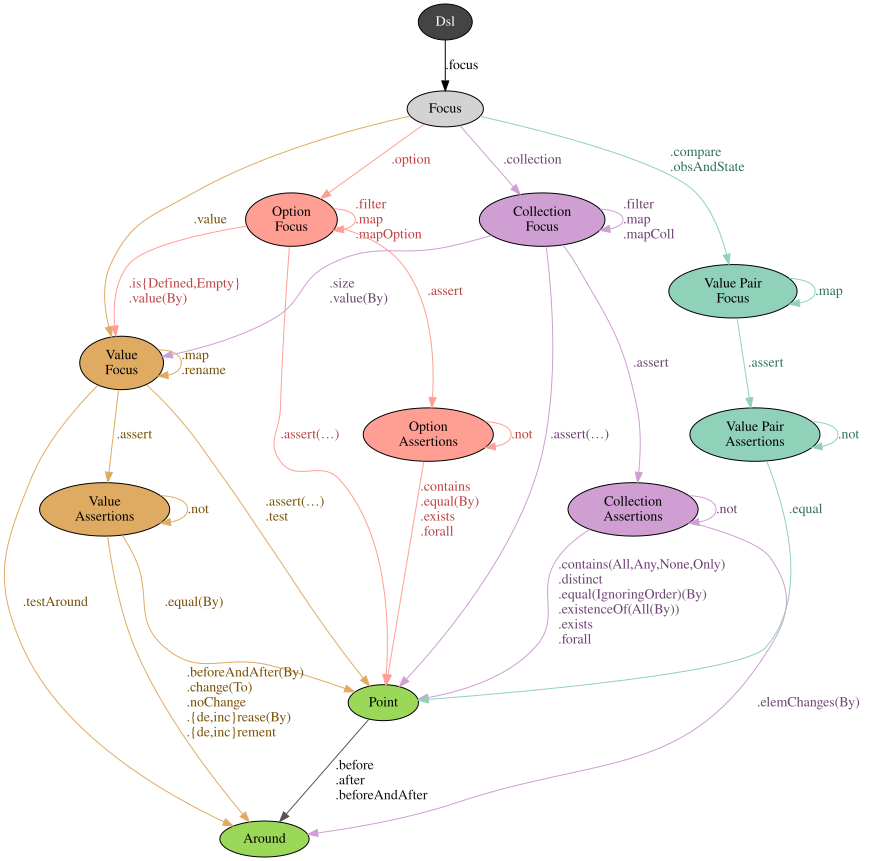

# DSL

Create a dsl instance by simply calling `Dsl.apply`, example:

```scala
import TestState._

val dsl = Dsl[Ref, Obs, State]

// dsl.emptyAction: Actions[Id, Ref, Obs, State, String]
```

or if you want asynchronous tests, you can use the helper method `Dsl.future`, example:

```scala
import TestState._
import scala.concurrent.ExecutionContext.Implicits.global

val dsl = Dsl.future[Ref, Obs, State]

// dsl.emptyAction: Actions[Future, Ref, Obs, State, String]
```

If you're using the Cats Effect or ZIO modules you can use those too:

```scala
import TestState._

val catsEffectDsl = Dsl.io  [Ref, Obs, State] // Dsl[cats.efffect.IO, Ref, Obs, State, String]
val zioDsl        = Dsl.task[Ref, Obs, State] // Dsl[zio.Task,        Ref, Obs, State, String]
```

If you want to specify a custom error type rather than `String`,
use `Dsl.full` to specify the full range of type parameters:

```scala
enum Error:
  case PageNotFound
  case LoginFailed
  case ServerOverloaded
  case VerificationFailed

val dsl = Dsl.full[Id, Ref, Obs, State, Error]
```

Once you have an instance, you can create your test content as follows:


You can create assertions here but it's more convenient to use the *focus* DSL below.

Instead, the most common path here is the `Action` path.
The majority of your test actions will be created like this:

```scala
// .action .apply is the most common path
dsl.action("Launch missiles")(_.ref.missiles.nukes.launchAllNow())
```

## Looping

You can create a looping super-action by using `dsl.loop(name)(loopingFunction)`.
The looping function takes as input an `ROS` (i.e. Ref + Obs + State), and returns a `LoopStep` value.
`LoopStep` values can be constructed via the following:

```scala
/** Run actions and continue the loop. */
dsl.loop.act(actions: Actions)

/** Break the loop. */
dsl.loop.break

/** Report a failure. */
dsl.loop.fail(failure: E)

/** Sleep for a specified duration then continue the loop. */
dsl.loop.sleep(duration: Duration)

/** Sleep for a specified number of milliseconds then continue the loop. */
dsl.loop.sleepMs(milliseconds: Long)

/** Update the state and continue the loop. */
dsl.loop.setState(s: S)

/** Update the state and break the loop. */
dsl.loop.setStateAndBreak(s: S)

/** Update the state, sleep for a specified duration, then continue the loop. */
dsl.loop.setStateAndSleep(s: S, duration: Duration)

/** Update the state, sleep for a specified number of milliseconds, then continue the loop. */
dsl.loop.setStateAndSleepMs(s: S, milliseconds: Long)
```

Example:

```scala
class Counter(var value: Int = 0) {
  def inc(): Unit =
    value += 1
}

val dsl = Dsl[Counter, Int, Unit]
val observer = dsl.observer(_.value)
val inc = dsl.action("Inc")(_.ref.inc())
val loop = dsl.loop("Count to 3") { ros =>
  if (ros.obs < 3)
    dsl.loop.act(inc)
  else
    dsl.loop.break
}

val counter = new Counter(0)
val report = Plan.action(loop).test(observer).stateless.withRef(counter).run()
```

which generates a report like this:

```txt
✓ Count to 3
  ✓ Inc
  ✓ Inc
  ✓ Inc
✓ All pass.
Performed 3 actions, 0 checks.
```

## Focus

*Focus* DSL exists to allows you make assertions easily and repeatedly,
about a particular value, or number of values.



Examples:
```scala
// Focus on a single value
val moneyRemaining = dsl.focus("Money remaining").value(_.obs.balance)
moneyRemaining.assert(0)
moneyRemaining.assert.beforeAndAfter(500, 600)
moneyRemaining.assert.increaseBy(100)
moneyRemaining.assert.noChange

// Focus on a collection
val names = dsl.focus("User names").collection(_.obs.userNameList)
names.assert.distinct
names.assert.contains("Bob")
names.assert.equalIgnoringOrder("Bob", "Jane")
names.size.assert.decrement

// Comparing observation & expected state
val itemCount = dsl.focus("Item count").obsAndState(_.items.size, _.expectedCount)
itemCount.assert.equal
itemCount.assert.not.equal
itemCount.obs.assert(0)
```
